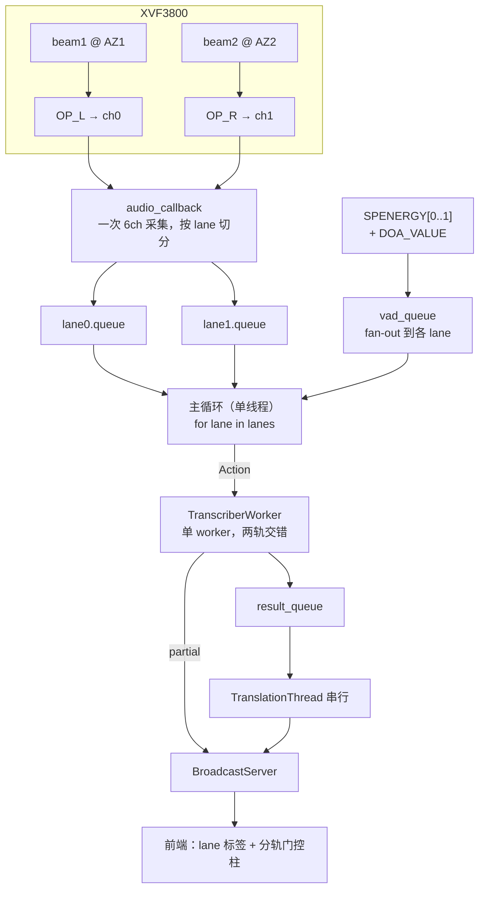

# 架构

一句话：XVF3800 硬件负责音频增强与空间感知，Python 单进程多线程流水线负责门控/分段/识别/翻译，浏览器负责显示与运行时控制。

可选的双轨模式（`--beam-lanes`）在同一套流水线上再跑一条独立的字幕通道，两条 lane 各绑一个固定波束；不启用时一切照旧。见 §8。

## 1. 执行流（6 + 1）

| # | 执行流 | 类型 | 节拍 | 职责 |
|---|---|---|---|---|
| 1 | audio_callback | PortAudio 线程 | 按块 | 6ch 按 lane 切分各通道，入各 lane 的 audio_queue |
| 2 | VadDoaReader | daemon | 100ms | USB 读 DOA_VALUE + AEC_SPENERGY_VALUES，入 vad_queue |
| 3 | 主循环 | 显式循环 | sleep(0.1) | 排空队列、每 lane 门控裁决、分段状态机、结果派发 |
| 4 | TranscriberWorker | daemon | task_queue.get(0.5) | ASR 串行推理，保序；单 worker 服务所有 lane |
| 5 | TranslationThread | daemon | job_queue.get(0.5) | NLLB 串行翻译 |
| 6 | BroadcastServer | asyncio | _pump 10ms | WebSocket 广播 |

主循环内所有重操作都是队列 put；USB 控制传输（RETRY 可达 1s+）被 VadDoaReader 隔离在控制面。

**双轨下主循环仍是单线程**，只是内部 `for lane in lanes` 遍历（见 §8）：两个 `Segmenter` 由两个线程驱动会竞态，且会破坏 100ms 节拍语义。

## 2. 三层门控

```
① 硬件 VAD   XVF3800 固件能量门，走控制面
② 软件 VAD   Silero torch jit，主循环内联，512 帧 + carry
③ 段级过滤   flush 时 O(1)：时长 → 占比 → 能量
```

模式 `--vad-gate hw|and|confirm|energy`（默认 `and`）。`and` 每拍合取；`confirm` 硬件开门后由软件连续确认/否决；`energy` 用**每波束**的 `SPENERGY` 取代**设备级**的硬件标志，是双轨唯一能分轨的门控（见 §8.3）。

关键语义：

- Silero `reset()` 只在段真正结束后调用（段边沿清零会冷启动 RNN 误杀开段）
- 占比分母只统计到最后一个有声 tick（句尾静音等待期不计入，防短句被稀释）
- 时长只累加门开期间的样本（有声时长）：尾静音等待期约 0.6s，若计入则 `min_seconds` 形同虚设、短句豁免的 1s 阈值也会错位
- 短句豁免仅对 <1s 且峰值概率 ≥0.5 的段生效（纯 avg_prob 豁免会放行 AGC 底噪）
- 所有丢弃统一走 `discard_segment()`：stream_abort + 广播 discard + 清缓冲 + 复位 + 回 IDLE（防 partial 残留）

## 3. 分段状态机

```
IDLE → SPEAKING → TRAILING_SILENCE → FLUSH ─┬→ DISCARD（统一丢弃路径）
                                             └→ SUBMIT_ASR
```

- 音频三归属：utterance（正文）/ pre_roll（1.0s 环形缓冲，开段时整体作 seed 喂给流式模型）/ 丢弃
- pre_roll 无条件喂入（含静音），保证开段瞬间窗口已满；flush/discard 都清空它，否则尾部语音会让下一段流重复解码出可见重复文本
- 参数：`vad_interval=0.1s`、`silence_hold=0.6s`、`min_seconds=0.3`、`max_seconds=20`、`pre_roll=1.0s`
- 超长段强制切分；DOA 众数随段保存（仅展示与波束参考，不参与过滤）
- 实现见 `segmenter.py`：`Segmenter` 持有单个 lane 的全部状态，`feed(chunks, gate_fn, hw_vad, now)` 每次 tick 返回 `Action` 列表（`open`/`feed`/`flush`/`discard`），由 `main.py` 的 `apply_actions()` 翻译成对转录器与前端广播的调用。软 VAD 概率在 `Segmenter` 内部计算一次，同时驱动门控判定、统计与句尾确认，避免同一个 tick 出现多个读数
- 该文件是纯逻辑、无 I/O，可脱离硬件测试（`tests/test_segmenter.py`）；`trim_tail()` 同时被 flush 的第三层过滤器与最终离线解码复用
- 日志措辞由 `Segmenter` 生成（`Action.flush_line`/`debug_line`），单 lane 模式下 `tag` 为空，输出与重构前逐字一致

## 4. 推理层

| 执行体 | 位置 | 模型 |
|---|---|---|
| sw VAD | 主循环内联 | Silero torch jit（官方 silero-vad 包 / 本地 silero_vad.jit） |
| ASR | TranscriberWorker | FunASR paraformer-zh + ct-punc（主）/ faster-whisper（兜底） |
| 翻译 | TranslationThread | NLLB-200-distilled-600M ct2-int8（1.3B 目录存在时优先） |

FunASR 流式 2-pass 契约：流式 generate 返回**增量文本**，provider 累计拼接为 partial；`finish_online()` 用 `is_final=True` 冲出尾字并立即广播，整段音频交给 `FinalDecodeThread` 离线重解出 final 替换 partial。

流式解码参数：`chunk_size` 默认 `[5,8,4]`（480ms stride，`--asr-chunk-size 600` 可换回上游默认 `[5,10,5]`），并显式传 `encoder_chunk_look_back=4` / `decoder_chunk_look_back=1`（仅在 cache 首次初始化时生效）。provider 只在累积文本增长时返回 non-empty，避免同一 stride 内重复广播相同 partial。

语言路由：源语言由**识别文本的字形**判定（含假名→日语，含谚文→韩语，含汉字→中文，其余归为英语），不取 ASR 的 `language` 字段——FunASR 恒报 `zh`，那是"本模型输出中文"而非"听出的是中文"，若采信它则英语输入会走中→外分支，"其他语言→中文"形同虚设。非中文一律走 `other_to` 方向，未知源语种也照样翻译而非静默跳过。解码 beam=4 + length_penalty=1.0 + repetition_penalty=1.1；短段（<2 字符）不送翻译。

## 5. 数据流契约

原文先推、译文补推、按 id 合并：

```
flush 段(id) ──→ TranscriberWorker ──→ source(id) 立即广播
                        │
                        └→ TranslationThread ─→ translation(id) 补推
前端按 id 合并双语卡片，翻译不阻塞原文显示
```

消息协议：

```
出站  source{id,ts,doa,text,lang,lane,lane_label}
      partial{id,ts,text,lane,lane_label}
      final{id,ts,text,lang,lane,lane_label}
      discard{id,lane,lane_label}
      translation{id,ts,text,target_lang}
      vad.state{hw_vad,sw_prob,gate_mode,segment_state,lanes[]}
      cmd_result{ok,data|error}
入站  cmd: list_commands / read / write / get_target_langs / set_target_langs / get_zones / set_zones
```

`lane` 单轨恒为 0、`lane_label` 为空，前端据此**不显示徽章**。`vad.state` 的 `lanes[]` 只在多于一条 lane 时非空（`{lane,label,active,energy}`），顶层 `hw_vad`/`sw_prob`/`segment_state` **始终保留**，故单轨前端无需改动。`translation` 不带 lane——它按 `id` 归属，前端已在卡片上保留该 id。

延迟测量只留在后端终端（`[首字]` / `[耗时]` 行 + 退出汇总），前端是纯渲染器，不接收任何 latency 字段。

## 6. 前端

单文件 `web/index.html`（后端只有 `/` 与 `/index.html` 路由，CSS/JS 全内联）。深色玻璃拟态；字幕状态机 partial 即时整段替换（后端发的是累积文本）→ final 整段替换 → discard 删除 → translation 填充；无逐字动画，每条消息到达即刻上屏。卡片上限 50 条；断线指数退避重连；XSS 全量转义。

**双轨渲染（形态 a：单流 + lane 标签）**：卡片 `.meta` 增加 lane 徽章，按 `data-lane` 配色（lane0 = `--accent` 青、lane1 = `--accent-2` 紫）；顶部门控柱由一组变**每组每 lane 一组**，配色同徽章，`title` 带各轨能量。**单轨不显示徽章**且门控回落到单组——一轨模式下凭空多个"lane 0"只是噪声，且单轨外观须与引入双轨前一致。

`lane_label` 经 `esc()` 转义：Zone 标签是**用户可编辑的自由文本**，是真实注入面（已用标记载荷实测：渲染为字面文本、不创建元素）。

未采用双列并排（形态 b）：改动大（grid + 每列独立滚动与裁剪 + 小屏降级），且同时说话时 ASR 本身可能串，对齐布局反而放大混乱。待 P7 测出实际串扰程度再评估。

## 7. 波束路由与固定波束

### 7.1 输出路由（`BeamRouter`）

`recon()` 只读探测 → `describe()` 检测映射歧义（歧义时拒绝写入）→ `apply()` 先存原路由、写后验证、失败 `restore()` 回滚。门控/推理通道与候选波束通道相互独立。

### 7.2 固定双波束（`FixedBeamController`）

设备只有 **2 个可编程固定波束**（beam1/beam2），另有 free-running 与 auto-select 两个由固件派生、不可编程。把 beam1/beam2 分别指向两个已知座位、并开启能量门控，是硬件本身对"两人串音"的答案：能量低的那一侧被**静音**而非混入，因此送进识别的音频里只有一个人。

- 写入序列：`AZIMUTH` → `ELEVATION` → `GATING` → **`SONOFF` 最后**
- `steer()` 全程存原值，失败或退出时 `restore()` 回滚

### 7.3 实测结论（firmware 2.0.8，2026-09-18）

以下均为设备实测，非文档推断：

| 结论 | 证据 |
|---|---|
| **方位单位是弧度** | 写 `1.5708` → 读回 `90.0`；若误写 `90.0` 则读回 `5156.6`（越界） |
| **指向精确跟随** | 写 (0,180)(30,210)…(330,150) 十二点，`AEC_AZIMUTH_VALUES[0..1]` 与写入值误差 < 0.5°，**12/12 命中** |
| **不需要先写仰角** | 省略 `ELEVATION` 时方位照样跟随（曾怀疑是前提，实测否定） |
| **逐波束能量有效** | beam1 指向扫过一圈时 `SPENERGY[0]` 从 107k → **378k 峰(120°)** → 归零，随指向显著变化 |
| **能量选波束机制成立** | `SPENERGY[3]`(auto-select) 恒等于 `max(SPENERGY[0], SPENERGY[1])`，12/12 样本成立 |
| **固定模式下自由波束停用** | `SONOFF=1` 时 `SPENERGY[2]`(free-running) = 0 |
| **方位读数会漂移** | `AEC_AZIMUTH_VALUES[2]/[3]`（free/auto，`DOA_VALUE` 报的就是它）空房间内 5 次读到 89→58→181→43→182，**不适合作为方位判据** |

**已验证**（2026-09-21，拍手激励）：`SPENERGY` 空房间为 0～42916，拍手期间峰值达 2.4M～4.3M，**量级差 50 倍以上**，作门控阈值绰绰有余。注意**静音时恒为 0**——交叉验证必须在发声期间轮询，拍手之前读只会得到全 0。

**仍未验证**：`SPENERGY` 能否在**两人同时说话**时分离两个波束。这是双轨的核心卖点，也是 6.7cm 孔径物理上限所在。已知能量读数有效，"能分出两个人"仍属推断，须待 P7 实测。

### 7.4 采集通道映射（`--beam-channels`）

采集流恒为 **6 通道**，路由选择（`OP_L`/`OP_R`）只决定**前两个**通道装什么，通道 2–5 是固定的四路原始麦克风，不受路由影响。项目 CLI 的 `--audio-source` 与之一一对应：

| 通道 | `--audio-source` | 内容 |
|---|---|---|
| ch0 | `conference`（默认） | 处理输出（AEC+波束+后处理） |
| ch1 | `asr` | ASR 波束输出（auto-select，无后处理） |
| ch2–ch5 | `mic0`–`mic3` | 四路原始麦克风 |

`AUDIO_MGR_OP_ALL` 的 12 个字节是 6 组 `<category>, <source>`。**category 号是观测值，不是文档枚举**（XMOS 公布了 pair 格式，未公布号码），因此 `pair_name()` 对没见过的号码一律输出 `cat?N`，绝不猜测：

| category | 含义 | 依据 |
|---|---|---|
| 8 | 处理后的 "Conference" 输出 | 设备出厂 `L = (8,0)`，与 ch0 描述吻合 |
| 7 | ASR 输出路径，**source = 波束索引** | 实测确认，见下 |
| 1 | 逐麦克风信号 | 设备在四个次级槽填了 `(1,0)(1,2)(1,1)(1,3)`，source 0–3 恰是四路 |
| 4 / 12 | 远端参考：原始 / 含增益与延迟 | 出自 XVF3800 文档（唯一有具体数值的映射） |

#### 实测结论（2026-09-21）

以下均为设备实测，非文档或推断：

| 结论 | 证据 |
|---|---|
| **`OP_L` → ch0，`OP_R` → ch1** | 把两槽切到远端参考 `(4,0)`/`(12,0)`。远端参考在**无播放时是数字静音（精确 0.0）**，切后 ch0/ch1 跌至 −158/−189 dB 即精确零；ch2–5 仅动 +0.5～0.7 dB |
| **ch2–5 完全不受路由影响** | 同上。这正是不用播放而用静音法的原因：一播音频，ch2–5 作为麦克风也会响，就分不清"路由改变"与"声学耦合" |
| **ch2–5 = 环形序相邻麦克风** | TDOA 拟合：`ch2..ch5 = mic0..mic3` 残差 **19.4 µs**（阵列理论上限 275 µs）；最佳**乱序**排列需 **67.2 µs**，被否决。故 `--audio-source mic0..mic3` 的通道号映射可用 |
| **cat 7 的 source 是波束索引** | 见下，为双轨方案的**地基** |

**cat 7 的判定方法（调制法）**：把 `OP_L/OP_R` 设为 `(7,0)/(7,1)`，`GATING=0`，然后在**一次连续录音内**每 2s 交换两波束指向、要求操作者全程持续拍手，比较每段的 ch0/ch1 能量平衡：

```
段   beam 对你    ch0       ch1     平衡dB
1    beam2     0.03244   0.03576   -0.8
2    beam1     0.07059   0.05444   +2.3
3    beam2     0.01921   0.02085   -0.7
4    beam1     0.07740   0.04978   +3.8
5    beam2     0.04270   0.06666   -3.9
6    beam1     0.06555   0.04991   +2.4
7    beam2     0.01999   0.03849   -5.7
```

7/7 全部跟随：`beam1` 对着说话人时平衡为正、`beam2` 对着时必为负，两组均值差 **5.6 dB**、组内散布仅 **1.6 dB**。

```
(7,0) = beam1 → ch0
(7,1) = beam2 → ch1
```

**对双轨方案的意义**：这正是双轨需要的"每轨一个固定波束"，且两轨同处一个 DSP 阶段、可比性最好，**无需任何波束扫描**。

#### 方法上的坑（勿重复踩）

- **"复盘式"对比（两次独立拍手）不成立**：它假设操作者站着不动。实测三次独立 session 中，两个**完全相同**的 steer 配置给出矛盾结果，电平还掉了 10 倍——结论全是噪声。改为**一次连续录音内切换**后，漂移变成慢变且两通道共享，在 ch0/ch1 **平衡值**里自动抵消，而波束切换是阶跃。数据可见：第 7 段 `ch1` 比第 3 段高 84%（人确实在漂），但平衡值不受影响
- **单次翻转不构成证明**：两通道下无效应时也有 50% 概率翻转。必须要求**每次切换都跟随**（7 次全中，偶然概率 1/64）
- **判据用效应量，不用相关系数、也不用 dB 阈值**：小而**完美重复**的 ±1 dB 是真实证据（噪声不会规律同相），大但有组内散布的摆动则不是。本项目用 `组间均值差 vs 组内散布`
- **拍手是瞬态**，用整窗 RMS 会把它稀释约 30 dB（10 次 5ms 拍手在 5s 窗上只剩噪声底）。应取**短窗峰值**（25ms 窗 RMS 的最大值）：合成数据下区分度由 8 倍提升到 34 倍

#### 仍未定论

`--audio-source micN` 命名的是**固件 source 槽位**，不是物理方向。要把"哪颗物理角"定死需要一个**已知方位的声源**：方形阵列旋转对称，循环移位不可观测（拟合时自由方位角会吸收它），故实测只能确定"环形序"、无法区分正/反向的 8 种等价解。这对字幕用途无影响（选任一颗麦克风都是确定的一颗）。

外部资料称 ch2–5 的 category 为 3 而本机实测为 1，且称其"不可更改"而路由表次级槽有值——两者其实不冲突：`AUDIO_MGR_OP_PACKED=[0,0]` 时只有每侧首源进 L/R，PK1/PK2 里的值是惰性默认。

### 7.5 注意事项

- **`AEC_FIXEDBEAMSONOFF` 只能在运行期配置**：写入固件配置并保存可能导致设备重启后挂起。本项目**从不持久化**——见 `usb_device.FLASH_PERSIST_CMDS` 的守卫（4 层，任一路径都拦得住）
- **扫描前必须读回 `SONOFF` 确认生效**，并留 0.3s 以上稳定期。曾出现一次 36 点扫描方位读数被二次换算的异常（32 倍缩放），三次受控重跑均未复现，成因未明
- 扫描期间开 `SONOFF` 会改变输出音频（ch0/ch1），因此扫描应在开始字幕**之前**一次性完成

### 7.6 工具

```
--beam-probe          只读巡检全部波束参数（度数/弧度双显）
--beam-scan           扫描找峰：自动定位说话人方位
--beam-fixed AZ1 AZ2  手工指定两波束方位（度），默认扫完即回滚
--beam-fixed-no-gating  关闭能量门控
--beam-apply-in-run   运行期保持，不自动回滚
--beam-recon / --beam-select  输出通道路由探测与切换
--beam-channels       只读巡检：两个可编程输出落在哪个采集通道
```

`tools/` 下的离线探针（均只读或带回滚，不写 flash）：

| 工具 | 回答的问题 |
|---|---|
| `p2a_capture.py` | 6 个采集通道各装什么（相关性 + 频谱指纹） |
| `p2_guided_channels.py` | ch2–5 与四路原始麦克风的次序（TDOA 反解，`--selftest` 可脱机验证判定逻辑） |
| `p2b_beam_channels.py` | cat 7 的 source 是否是波束索引（调制法，含反向/负对照） |
| `p2_channel_probe.py` | 路由落点（远端参考注入法） |
| `p15_interleave_probe.py` | 单实例能否服务两条交错流（ASR 侧） |

## 8. 双轨（`--beam-lanes`）

未传 `--beam-lanes` 时**一切照旧**：单条 lane，日志无前缀，行为与引入双轨前逐字相同。这是硬约束——单轨不是"特例分支"，而是 `lanes` 列表只有一个元素，**只有一条代码路径**，没有第二条可以漂移。

### 8.1 Lane 抽象

```
Lane = (index, channel, beam_index, azimuth, label, tag,
        queue, hw_vad, energy, confirm_pending, confirm_sw_reject,
        energy_active_at, segmenter, vad, locator)
```

**必须每 lane 独占**的状态，以及共享的后果：

| 状态 | 共享的后果 |
|---|---|
| `SileroVad` | RNN 状态在模型对象内 → 两轨互相损坏（与两流共用一个 ASR cache 同类） |
| `Segmenter` | 18 个标量段状态与 pre-roll 环形缓冲会被交错，两个人说话会混进同一段 |
| `confirm_pending/reject` | 一轨的硬件 tick 会推进**另一轨**的否决计数 |
| `SpeakerLocator` | 开段时的 `reset()` 会清掉另一轨的统计 |

控制面（`DOA_VALUE`/`SPENERGY`）是**设备级**的，因此 fan-out 给所有 lane；差异只在解释方式，那部分在 `gate_verdict` 里。

### 8.2 数据流



主循环**仍是单线程**，内部 `for lane in lanes`。不开两条主循环线程：两个 `Segmenter` 的时序竞态不可控，且会丢掉 100ms 节拍语义（延迟数字依赖它）。

**一次采集扇出，而不是每 lane 一条流**：两条 PortAudio 流指向同一 USB 设备会直接崩溃（实测 `double free or corruption`），且两流时钟不同步。

### 8.3 每轨门控

```
lane_active = SPENERGY[beam_index] > --beam-energy-threshold
gate        = lane_active AND sw_prob >= SW_FRAME_THRESHOLD
```

- `--vad-gate` 新增 `energy`；**单轨默认仍 `and`（硬件）**，双轨自动切 `energy`
- 为什么必须用能量：`DOA_VALUE[1]` 是**设备级**单一标志，无法区分哪条波束听到了声音；`SPENERGY` 是**每波束**的。这是双轨唯一可用的分轨信号
- **必须的保持窗口**：`SPENERGY` 静音时**精确为 0**，瞬时阈值会在**每个词间停顿**就关门、切碎句子。保持窗口复用 `silence_hold`——它回答的是**同一个问题**（"这句还在说吗"），两个信号语义相同，构造上一致
- 阈值默认 200000（实测噪声上限 42916、拍手 2.4M～4.3M），**是标定起点而非调优值**

### 8.4 并发与文案归属

- **单 worker 服务两轨**：`FunasrProvider._utts` 已按 `stream_id` 索引，实测两流交错调用同一 `AutoModel` **数值正确**（含负对照：强制共享 cache 会明显污染）→ 内存 1x
- 代价是推理串行，轨 2 的 feed 排在轨 1 之后；**吞吐未测**，P7 若轨 2 首字滞后 >30% 再评估双 worker
- `Task`/`FinalRequest`/`AsrResult.meta`/所有出站消息带 `lane` + `lane_label`
- **方位标签来自配置的指向**查 Zone 表（`locator.label_for(az)`），**不读设备 DOA**——后者空房间会漂移（89→58→181→43→182）
- 两轨标签重名会警告（徽章将无法区分）

### 8.5 与单轨固定波束方案的关系

| | 单轨（`--beam-fixed`） | 双轨（`--beam-lanes`） |
|---|---|---|
| `GATING` | **1**（能量选活跃波束，另一侧静音） | **0**（两波束都必须活着） |
| 输出路由 | 不改 | `OP_L=(7,0)` / `OP_R=(7,1)` |
| 用途 | 单人场景抑制房间混响 | 两人各占一轨 |

**两者互斥**：双轨下 `GATING=1` 会在一个人说话时静音另一条 lane。

### 8.6 CLI

```bash
--beam-lanes AZ1 AZ2          # 启用双轨，两波束指向（度）；不传即单轨
--beam-lane-channels CH0 CH1  # 采集通道，默认 0 1（即 OP_L/OP_R 落点）
--beam-no-route               # 只采集不写路由/不转向（验证分流，零风险）
--beam-lane-labels L0 L1      # 覆盖标签（默认按方位查 Zone 表）
--beam-energy-threshold N     # 每轨能量阈值
```

退出时**路由与转向都会被恢复**，并打印每轨段统计。全程不写 flash。

## 9. 延迟预算（基线）

```
译文端到端 ~1.0s = silence_hold 0.6s(~60%) + 轮量化 ~10% + ASR 0.15~0.25s + NLLB 0.2~0.3s + WS <20ms
```

推理仅占 ~0.4s，优化重点在切句策略（软件 VAD 连续低概率帧提前 flush）而非模型。翻译（600M）增量 ~0.2–0.4s，因与 source 广播解耦，不阻塞原文显示。

**双轨注意事项**：单 worker 串行意味着轨 1 的推理会推迟轨 2 的 feed。此代价**尚未测量**——P7 需比较两轨的 `[首字]`，若轨 2 滞后超过 30% 再考虑升为双 worker（内存 ~2x）。

```
译文端到端 ~1.0s = silence_hold 0.6s(~60%) + 轮量化 ~10% + ASR 0.15~0.25s + NLLB 0.2~0.3s + WS <20ms
```

推理仅占 ~0.4s，优化重点在切句策略（软件 VAD 连续低概率帧提前 flush）而非模型。翻译（600M）增量 ~0.2–0.4s，因与 source 广播解耦，不阻塞原文显示。
